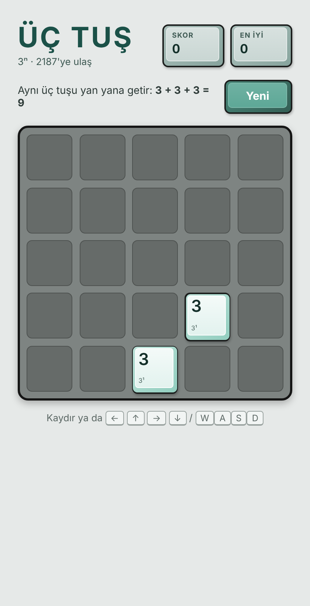
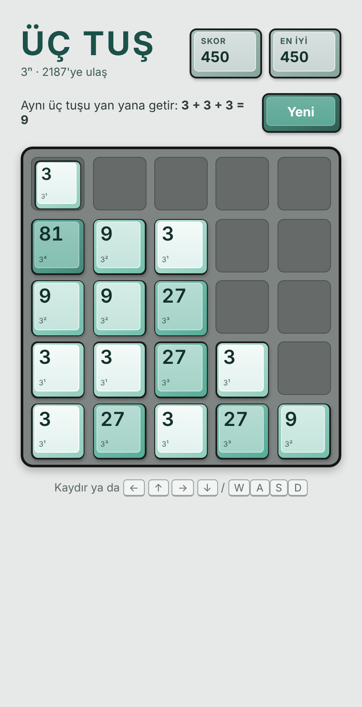

# Üç Tuş

2048'in 3'ün kuvvetleriyle (3, 9, 27, 81, 243, 729, 2187, 6561…) oynanan versiyonu.
Her blok, mint tonlarında eğimli bir klavye tuşu gibi görünür. Flutter ile yazıldı.

<p align="center">
  
  &nbsp;&nbsp;
  
</p>

## Oynanış

- 5×5 tahta. Aynı değerdeki **üç** tuş yan yana gelince birleşir: 3 + 3 + 3 = 9, 9 + 9 + 9 = 27…
- Her hamleden sonra %90 ihtimalle 3, %10 ihtimalle 9 gelir.
- Hedef: **2187** (3⁷). Sonrasında 6561 için devam edebilirsin.
- Telefonda kaydırarak, bilgisayarda ok tuşları ya da WASD ile oynanır.
- En iyi skor cihazda saklanır (`shared_preferences`).

## İndir

En güncel APK [Releases](../../releases) sayfasında. Her `main` güncellemesinde derlenen APK'yı
[Actions](../../actions) sekmesinden de indirebilirsin.

## Kendin çalıştır

```bash
git clone https://github.com/muba14/uc-tus.git
cd uc-tus
flutter create . --platforms android   # android/ klasörünü oluşturur
flutter pub get
flutter run
```

## Proje yapısı

```
lib/main.dart                  Oyunun tüm kodu (mantık + arayüz)
pubspec.yaml                   Proje adı, sürüm ve paketler
.github/workflows/build.yml    GitHub Actions: APK derler, etikette Release açar
screenshots/                   README görselleri
```
